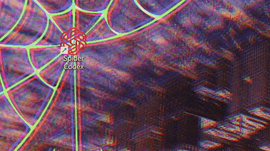
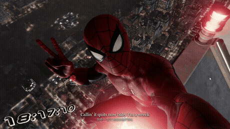

# Spider Codex

## [⬇ 下载 Windows x64 双角色版](https://github.com/Iris-change/spider-codex/releases/download/v0.2.0-beta/Spider-Codex-Windows-x64.zip)

**v0.2.0-beta** · [查看发布说明](https://github.com/Iris-change/spider-codex/releases/tag/v0.2.0-beta)

Spider Codex 是一个 Windows 桌面启动器，内置迈尔斯和红衣蜘蛛侠两套透明蛛丝动画。解压后双击 `Spider-Shortcut.exe`，**首次默认播放迈尔斯**。

点击右上角的 **`NEXT: MILES` / `NEXT: SPIDER-MAN`** 选择下次打开时播放的角色，**当前动画继续播放，不会重播**。任一角色播完后，点击 **SPIDERMAN WORKSPACE** 即可进入原生 Codex。按 `Esc` 或点右上角 `×` 可关闭。

## 双角色动画演示

| 迈尔斯 | 红衣蜘蛛侠 |
| :---: | :---: |
| [](docs/miles-launch.mp4) | [](docs/scarlet-launch.mp4) |
| [观看迈尔斯短片](docs/miles-launch.mp4) | [观看红衣蜘蛛侠短片](docs/scarlet-launch.mp4) |

## 构建与运行

需要 64 位 Windows、系统里的 .NET Framework 4.x 构建工具，以及通过 Microsoft Store 安装的 Codex。Codex 的注册应用 ID 为 `OpenAI.Codex_2p2nqsd0c76g0!App`。

在项目目录运行 PowerShell：

```powershell
.\build.ps1
```

创建桌面快捷方式时可使用 `Spider-Codex.ico`。请让两套动画素材目录和 `Spider-Shortcut.exe` 保持在同一目录。

## 许可与素材

启动器源码和构建脚本采用 [MIT](LICENSE)。动画帧和图标随本项目提供，用于展示和运行启动器。MIT 的授权范围限于代码。蜘蛛侠、迈尔斯及相关标志的权利归各自权利人。

## 测试版

已在本机验证动画和原生 Codex 跳转。尚待在全新 Windows 环境验证冷启动及未安装时的提示。
